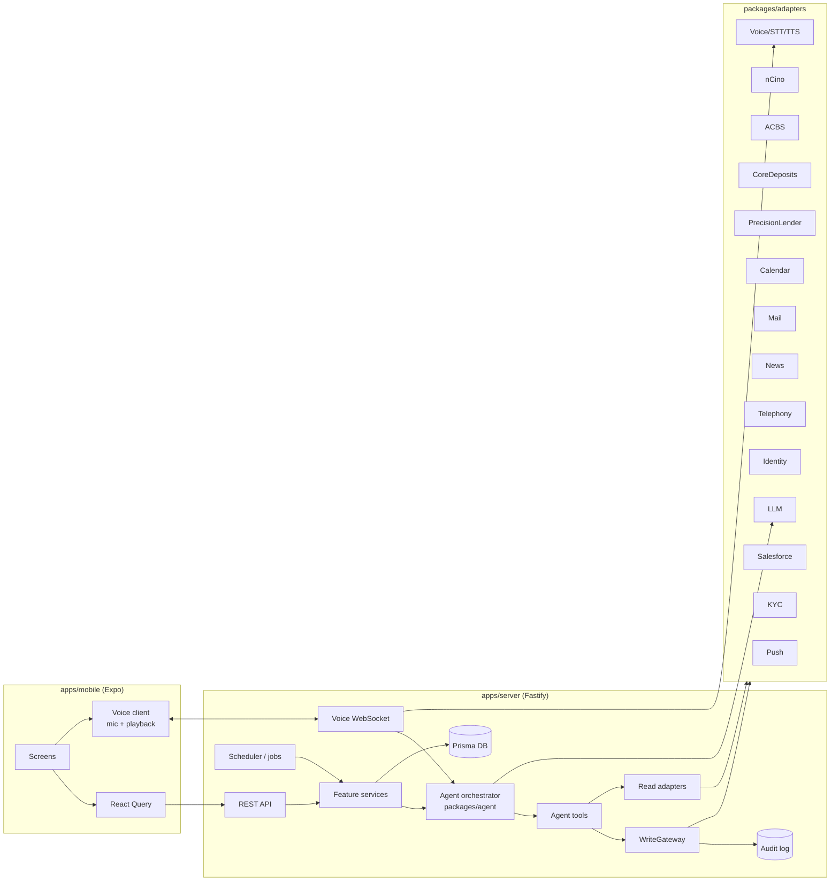
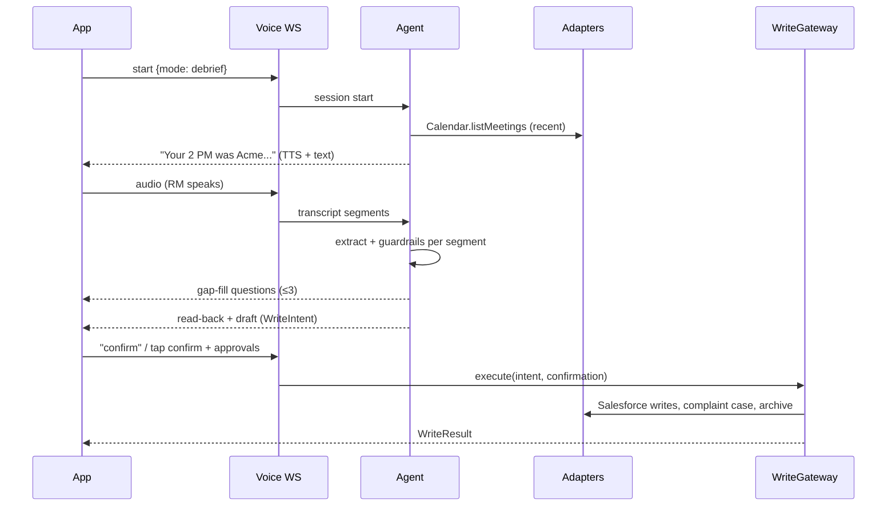

# 02 — Architecture

## 1. System overview



- Mobile talks to the server only. It never calls OpenAI or external systems directly, and never holds the OpenAI key.
- All external systems are behind adapter interfaces with `mock` implementations; `live` implementations are added later without touching features.
- All writes go through `WriteGateway`.

## 2. Monorepo layout (detailed)

```
apps/mobile/
  app/                         expo-router routes
    (auth)/sign-in.tsx
    (tabs)/_layout.tsx         Today | Accounts | Ask (center) | Alerts | Me
    (tabs)/today.tsx
    (tabs)/accounts/index.tsx
    (tabs)/accounts/[id].tsx
    (tabs)/alerts.tsx
    (tabs)/me.tsx
    debrief/[sessionId].tsx    voice/chat capture
    debrief/review/[draftId].tsx
    debrief/saved/[debriefId].tsx
    brief/[meetingId].tsx
    drafts/[debriefId].tsx     follow-up drafts
    referral/new.tsx
    deal/new.tsx
    documents/[accountId].tsx
    coverage/index.tsx
    live/[meetingId].tsx       F11 (flagged)
    pricing/[dealId].tsx       F12 (flagged)
    settings/index.tsx
  src/
    api/                       typed client generated from packages/shared schemas
    components/                design-system components (see 06-mobile-ux)
    features/<feature>/        hooks + feature components
    voice/                     recorder, player, ws client, VAD
    theme/                     tokens
    i18n/en.ts
apps/server/
  src/
    config.ts                  zod-validated env
    server.ts                  Fastify bootstrap
    auth/                      session, entitlements middleware
    routes/                    one file per resource (see 04-api-contract)
    ws/voice.ts                voice session gateway
    services/                  debrief, brief, drafts, tasks, referrals, alerts, deals, documents, insights, coverage, live, pricing, health
    jobs/                      scheduler (node-cron) and job handlers
    write-gateway/             WriteGateway + confirmation tokens
    audit/
    flags/                     feature flags loader + guard
  prisma/schema.prisma
  prisma/seed.ts               loads docs/07 seed spec
packages/shared/src/
  types/                       domain types
  schemas/                     zod request/response schemas
  flags.ts                     flag names
packages/agent/src/
  orchestrator.ts
  tools/                       one file per tool (see 05)
  prompts/                     system + task prompts
  extraction/                  JSON schemas + validators
  guardrails/                  complaint, mnpi, sensitive, commitment, internalOnly
  speech/                      read-back formatting (numbers, dates)
packages/adapters/src/
  interfaces/                  *.ts interfaces
  mock/                        deterministic in-memory/DB-backed mocks
  live/                        placeholders throwing NotImplemented
  index.ts                     factory: getAdapters(config)
packages/evals/
  golden/                      golden debriefs (transcript + expected draft)
  run.ts
```

## 3. Adapter interfaces (summary)

All adapter methods take a `ctx: RequestContext` (`{ rmId, entitlements, requestId }`) first. All return typed results from `packages/shared`.

| Adapter | Key methods |
|---|---|
| `IdentityAdapter` | `signIn(personaId)` (mock), `verifyPushApproval(sessionId)`, `getUser(rmId)` |
| `SalesforceAdapter` | `getAccount`, `listAccounts(bookFilter)`, `getContacts`, `getActivities(accountId, limit)`, `getOpenOpportunities`, `getOpenCases`, `getTasks(filter)`, `createDebrief`, `createAttendees`, `createTasks`, `updateTask`, `createOpportunity`, `updateOpportunity`, `upsertContact`, `updateEvent`, `createReferral`, `updateReferral`, `createComplaintCase` |
| `NcinoAdapter` | `getLoans(accountId)`, `getCovenants`, `getTicklers`, `getRiskRating`, `createDraftRequest`, `getSpreads` |
| `AcbsAdapter` | `getFacilityBalances(accountId)`, `getUtilizationHistory` |
| `CoreDepositsAdapter` | `getBalances(accountId)`, `getBalanceHistory(days)`, `getTreasuryProducts` |
| `PrecisionLenderAdapter` | `getRelationshipProfitability`, `getPricingGuidance(dealParams)` |
| `CalendarAdapter` | `listMeetings(range)`, `getMeeting`, `createHold` |
| `MailAdapter` | `createDraft(message)` — **no `send` method exists** |
| `NewsAdapter` | `getNews(accountName, days)` |
| `KycAdapter` | `getRefreshRequirements(accountId)` |
| `TelephonyAdapter` | `onInboundCall(handler)`, `streamAudio`, `playAudio` (mock only this build) |
| `PushAdapter` | `send(rmId, notification)` (mock logs + Expo push in dev if token present) |
| `LlmProvider` | `chat({messages, tools, responseFormat})`, `stream(...)` — impls: `mock`, `openai` |
| `VoiceProvider` | `transcribeStream`, `synthesize(text)`, `realtimeSession?` — impls: `mock`, `openai` |
| `ArchiveAdapter` | `storeTranscript(transcript) → ref` |

Mock adapters persist to the dev DB tables prefixed `mock_` so state survives restarts and tests can inspect call logs (`mock_call_log`).

## 4. WriteGateway

Single choke point for external writes.

```ts
interface WriteIntent {
  id: string;                    // uuid
  rmId: string;
  kind: 'debrief.save' | 'task.update' | 'task.delegate' | 'referral.create'
      | 'deal.draft' | 'calendar.hold' | 'mail.draft' | 'alert.action' | 'contact.upsert';
  payload: unknown;              // validated per kind
  requiresApproval: ApprovalItem[];  // e.g. opportunity create
  createdAt: string;
  expiresAt: string;             // 15 minutes
}
interface Confirmation {
  intentId: string;
  confirmedBy: string;           // rmId
  channel: 'voice' | 'tap';
  approvals: Record<string, boolean>;  // per ApprovalItem id
  utterance?: string;            // e.g. "confirm"
}
```

Flow: services build a `WriteIntent` → return it to the client (or the voice agent reads it back) → client/agent submits a `Confirmation` → `WriteGateway.execute(intent, confirmation)` validates (same RM, not expired, approvals present), executes adapter calls in order, records an `AuditEvent` per external write with before/after and the confirmation, and returns a `WriteResult` listing written/held items. Idempotent on `intent.id`.

Hard rules enforced in code:
- Opportunity create/update executes only if `approvals[opportunityItemId] === true`.
- Complaint routing executes whenever `complaintFlag` is true, regardless of approvals.
- `MailAdapter` exposes no send method.

## 5. Feature flags

`config/features.json`:

```json
{
  "F01_DEBRIEF": { "enabled": true },
  "F02_BRIEF": { "enabled": true },
  "F03_DRAFTS": { "enabled": true },
  "F04_NUDGES": { "enabled": true },
  "F05_REFERRALS": { "enabled": true },
  "F06_WATCHLIST": { "enabled": true },
  "F07_DEAL_INTAKE": { "enabled": true },
  "F08_DOC_CHASE": { "enabled": true },
  "F09_TALKING_POINTS": { "enabled": true },
  "F10_COVERAGE": { "enabled": true },
  "F11_LIVE_LISTENING": { "enabled": false, "complianceApproved": false, "allPartyConsentStates": ["CA","FL","IL","MD","MA","MT","NH","PA","WA"] },
  "F12_PRICING_GUIDANCE": { "enabled": false, "complianceApproved": false },
  "F13_HEALTH_SCORE": { "enabled": false, "complianceApproved": false, "modelValidated": false }
}
```

The all-party-consent state list is a placeholder for Legal to confirm; do not treat it as legal advice.

A feature is active only if `enabled` and every gate key present is `true`. Server routes for inactive features return 404; the mobile app fetches `/v1/me/features` and hides inactive UI. Agent tools for inactive features are not registered.

## 6. Security model

- **Auth (mock):** sign-in screen lists seeded personas; server issues a session JWT (HS256 dev secret). Interface supports OIDC (Entra ID) later.
- **Phone channel auth:** push-approval or 6-digit voice PIN against registered device; caller ID alone is never sufficient.
- **Entitlements middleware:** resolves `rmId`'s book (account IDs) and team; every service call filters by it. Leaders get read-only team scope for coverage only.
- **Secrets:** OpenAI key only on the server, from env. Never logged.
- **Logging:** pino with redaction of `transcript`, `email.body`, `contact.email`, `phone` fields in logs.
- **PII to LLM:** a `PiiScrubber` runs before LLM calls in `openai` mode, replacing contact emails/phones and account numbers with tokens and restoring them after. Names of companies and people are kept (needed for quality) — acceptable only with synthetic data; production must use the approved enterprise endpoint.
- **Transport:** HTTPS/WSS in non-dev environments.

## 7. Key sequence flows

### 7.1 Voice debrief (F01)



### 7.2 Brief (F02)

`GET /v1/briefs/:meetingId` → `BriefService.assemble` runs adapter reads in parallel with a 2.5 s per-source timeout → builds `Brief` with `facts[]` (each with source/asOf) and `missingSources[]` → LLM renders `spoken` text from facts only (temperature 0.2) → cached 10 min.

### 7.3 Watchlist (F06)

Nightly job (02:00 local) per RM → `AlertService.evaluate(rules, book)` → create/update `Alert` rows → push for warn/critical in the morning agenda window.

## 8. Environments

| Env | Integrations | LLM/Voice | DB |
|---|---|---|---|
| dev | mock | mock or openai | SQLite |
| test (CI) | mock | mock | SQLite in-memory |
| staging (later) | live sandboxes | enterprise gateway | Postgres |

## 9. Non-functional targets

- API p95 < 400 ms (mock), brief assembly p95 < 3 s.
- Voice: first audio of agent reply ≤ 1.5 s after RM stops speaking (openai mode).
- Mobile cold start < 2.5 s on mid-range device.
- 100% of external writes have an audit record (tested).
